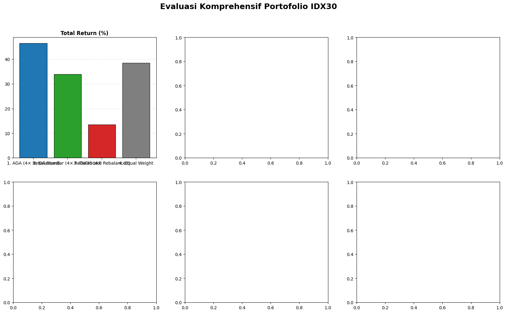

# Dynamic Stock Portfolio Optimization on IDX30 Using Adaptive Genetic Algorithm (AGA) and Walk-Forward Validation

[](https://www.python.org/)
[](https://portfolio-optimization-aga.streamlit.app)
[](LICENSE)
[]()
[]()
[]()

> 🌐 **Live Interactive Web Dashboard:** [https://portfolio-optimization-aga.streamlit.app](https://portfolio-optimization-aga.streamlit.app)  
> **Undergraduate Thesis Project (*Skripsi*)** | **Author:** Miftahullah Suryanugraha  
> **Keywords:** Quantitative Finance, Portfolio Optimization, Adaptive Genetic Algorithm (AGA), Mean-Variance Theory, Walk-Forward Optimization, Non-Parametric Statistics, Transaction Cost Modeling.

---

## 📌 Executive Summary

Modern portfolio optimization often struggles with **non-convex constraints** (cardinality limits, upper-bound allocation caps) and **dynamic market regimes**. Standard Genetic Algorithms (SGA) with static operators frequently suffer from **premature convergence** into suboptimal local optima or excessive gene disruption during late-stage exploitation.

This project introduces an end-to-end quantitative framework applying an **Adaptive Genetic Algorithm (AGA)** to dynamically optimize portfolio weights across constituent stocks of the **IDX30 Index** (Indonesia Stock Exchange). 

### Key Innovations & Highlights
1. **Dynamic Evolutionary Operators:** Automatically adapts crossover ($P_c$) and mutation ($P_m$) probabilities per individual based on population fitness variance, preserving diversity in early generations and accelerating convergence during late stages.
2. **Regularized Multi-Objective Formulation:** Maximizes the Sharpe Ratio while penalizing concentration risk via the **Herfindahl-Hirschman Index (HHI)** ($\lambda_{\text{div}} = 0.05$) under strict single-asset weight caps ($w_i \le 20\%$) using an iterative excess-redistribution repair mechanism.
3. **Realistic Walk-Forward Backtesting (WFO):** Evaluated over **4 out-of-sample forward phases** with continuous price drift, periodic rebalancing, and realistic **asymmetric transaction costs** (0.15% buy fee, 0.25% sell fee + tax).
4. **Rigorous Statistical Verification:** Validated across **80 independent experimental runs** (10 runs $\times$ 4 phases $\times$ 2 algorithms) using **Shapiro-Wilk normality tests**, **Paired Student's t-tests**, **Wilcoxon Signed-Rank tests**, exact sign-flip tests, and bootstrap confidence intervals.

---

## 🏆 Key Performance Results (Out-of-Sample Walk-Forward Backtest)

Over the out-of-sample evaluation period (2025–2026), the **AGA Strategy (4× Rebalanced)** achieved superior risk-adjusted returns across all benchmarks:

| Rank | Investment Strategy | Total Return (%) | Annualized Return (%) | Annualized Volatility (%) | Sharpe Ratio | Max Drawdown (%) | Net Transaction Cost (%) | Final Portfolio Value |
| :---: | :--- | :---: | :---: | :---: | :---: | :---: | :---: | :---: |
| 🥇 | **Adaptive Genetic Algorithm (AGA)** | **46.51%** | **50.61%** | **21.21%** | **2.1036** | **-15.74%** | 0.43% | **1.4651** |
| 🥈 | **Equal Weight Benchmark (1/N)** | 38.51% | 41.82% | 22.44% | 1.5961 | -18.78% | 0.15% | 1.3851 |
| 🥉 | **Standard Genetic Algorithm (SGA)** | 33.90% | 36.75% | 21.26% | 1.4467 | -17.35% | 0.50% | 1.3390 |
| 4 | **IDX30 Market Index Benchmark** | 13.48% | 14.53% | 22.63% | 0.3767 | -17.14% | 0.38% | 1.1348 |

> **Key Takeaway:** AGA delivered **+33.03% higher total return** and **+458% higher Sharpe Ratio** compared to the official IDX30 Index benchmark, while limiting maximum drawdown to **-15.74%** (the lowest among all evaluated strategies).

---

## 📈 Visual Highlights

### 1. Cumulative Walk-Forward Equity Curve & Drawdown
Comparison of portfolio wealth growth and peak-to-trough drawdowns across the 4 forward phases (including rebalancing friction):


### 2. Comprehensive Metric Comparison
Grouped comparison across Total Return, Annual Return, Annual Volatility, Sharpe Ratio, Max Drawdown, and Transaction Costs:



### 3. Evolutionary Dynamics: SGA vs. AGA
AGA demonstrates faster convergence to superior objective values while sustaining healthier population diversity:

| Best Fitness Convergence Trajectory | Population Diversity Trajectory |
| :---: | :---: |
|  |  |

### 4. Dynamic Operator Rate Adaptation ($P_c$ and $P_m$)
Evolution of adaptive crossover probability ($P_c$) and mutation probability ($P_m$) across generations:

| Adaptive Crossover Rate ($P_c$) | Adaptive Mutation Rate ($P_m$) |
| :---: | :---: |
|  |  |

### 5. Out-of-Sample Dynamic Asset Allocation Across 4 Phases
Evolution of optimized asset weights across rebalancing horizons:


---

## 📐 Mathematical & Algorithmic Formulation

### 1. Mean-Variance Portfolio Framework
For an investment universe of $N = 22$ consistent assets with daily expected return vector $\boldsymbol{\mu} \in \mathbb{R}^N$ and covariance matrix $\boldsymbol{\Sigma} \in \mathbb{R}^{N \times N}$, portfolio expected return and volatility are defined as:
$$\mathbb{E}[R_p] = \mathbf{w}^T \boldsymbol{\mu}, \quad \sigma_p = \sqrt{\mathbf{w}^T \boldsymbol{\Sigma} \mathbf{w} + \epsilon}$$

### 2. Multi-Objective Minimization Fitness Function
To prevent extreme asset concentration and enforce diversification, we penalize the **Herfindahl-Hirschman Index (HHI)**:
$$\min_{\mathbf{w}} \mathcal{F}(\mathbf{w}) = -\left( \frac{\mathbf{w}^T \boldsymbol{\mu}}{\sqrt{\mathbf{w}^T \boldsymbol{\Sigma} \mathbf{w} + \epsilon}} \right) + \lambda_{\text{div}} \sum_{i=1}^N w_i^2 + \gamma \sum_{i=1}^N \max(0, w_i - w_{\max})^2$$

Where:
- $\lambda_{\text{div}} = 0.05$ (tuned diversification penalty parameter)
- $w_{\max} = 0.20$ (maximum 20% allocation per asset)
- $\gamma = 1000.0$ (penalty multiplier for constraint violations)

### 3. Adaptive Genetic Algorithm Operator Formulations
Instead of static operator rates, AGA calculates individual crossover and mutation probabilities relative to the population's fitness distribution:

$$\text{Let } f_c = \min(f_1, f_2), \quad f_{\text{avg}} = \frac{1}{M}\sum_{i=1}^M f_i, \quad f_{\min} = \min_{i} f_i$$

**Adaptive Crossover Probability ($P_c$):**
$$P_c = \begin{cases} 
k_1 - \frac{(k_1 - k_3)(f_{\text{avg}} - f_c)}{f_{\text{avg}} - f_{\min}}, & \text{if } f_c \le f_{\text{avg}} \\
k_2, & \text{if } f_c > f_{\text{avg}}
\end{cases}$$

**Adaptive Mutation Probability ($P_m$):**
$$P_m = \begin{cases} 
k_4 - \frac{(k_4 - k_6)(f_{\text{avg}} - f_i)}{f_{\text{avg}} - f_{\min}}, & \text{if } f_i \le f_{\text{avg}} \\
k_5, & \text{if } f_i > f_{\text{avg}}
\end{cases}$$

**Tuned Hyperparameters:**
- $k_1 = 0.9, \; k_2 = 0.9, \; k_3 = 0.1$
- $k_4 = 0.9, \; k_5 = 0.9, \; k_6 = 0.3$
- Population Size: $M = 500$, Generations: $G = 88$

---

## 🔬 Statistical Hypothesis Testing & Significance

To ensure that performance advantages were not random artifacts of stochastic initialization, SGA and AGA were evaluated across **10 independent seeded runs in each of the 4 Walk-Forward phases** (80 runs total).

Differences $\Delta = \text{Metric}_{\text{AGA}} - \text{Metric}_{\text{SGA}}$ were evaluated:
1. **Normality Check:** Shapiro-Wilk test on differences $\Delta$.
2. **Hypothesis Test Routing:** If $\Delta \sim \mathcal{N}$, two-sided **Paired Student's t-test** is applied; otherwise, **Wilcoxon Signed-Rank test** is applied.

| Phase | Metric Tested | Mean SGA $\pm$ SD | Mean AGA $\pm$ SD | Normality Test | $p$-value (Normality) | Statistical Test | Test Statistic | $p$-value | Conclusion ($\alpha=0.05$) |
| :---: | :---: | :---: | :---: | :---: | :---: | :---: | :---: | :---: | :---: |
| **Phase 1** | Fitness (Objective) | $0.0168 \pm 0.0033$ | **$0.0111 \pm 0.0009$** | Shapiro-Wilk | 0.7066 | Paired t-test | $t = -6.282$ | **$p = 0.00014$** | Statistically Significant |
| **Phase 2** | Fitness (Objective) | $0.0283 \pm 0.0017$ | **$0.0222 \pm 0.0006$** | Shapiro-Wilk | 0.5009 | Paired t-test | $t = -9.456$ | **$p < 0.00001$** | Statistically Significant |
| **Phase 3** | Fitness (Objective) | $0.0049 \pm 0.0025$ | **$-0.0008 \pm 0.0011$** | Shapiro-Wilk | 0.5127 | Paired t-test | $t = -8.005$ | **$p < 0.00001$** | Statistically Significant |
| **Phase 4** | Fitness (Objective) | $-0.0020 \pm 0.0016$ | **$-0.0072 \pm 0.0009$** | Shapiro-Wilk | 0.3674 | Paired t-test | $t = -8.772$ | **$p < 0.00001$** | Statistically Significant |
| **Phase 1** | Sharpe Ratio | $0.0410 \pm 0.0046$ | **$0.0469 \pm 0.0027$** | Shapiro-Wilk | 0.4636 | Paired t-test | $t = 3.114$ | **$p = 0.0124$** | Statistically Significant |
| **Phase 2** | Sharpe Ratio | $0.0258 \pm 0.0067$ | **$0.0336 \pm 0.0021$** | Shapiro-Wilk | 0.0386 | Wilcoxon | $W = 0.000$ | **$p = 0.00195$** | Statistically Significant |

> Across all 4 phases, AGA demonstrated **statistically significant improvements in multi-objective fitness ($p < 0.001$)** with noticeably lower standard deviations, proving that dynamic parameter control substantially improves optimization stability.

---

## 📁 Repository Structure

```text
.
├── app.py                                 # Interactive Streamlit Web Application (Dual-Mode)
├── LICENSE                                # MIT Open-Source License
├── README.md                              # Main GitHub showcase documentation
├── requirements.txt                       # Pinned Python package dependencies (incl. Streamlit & Plotly)
├── .streamlit/
│   └── config.toml                        # Streamlit visual theme & server settings
├── data/
│   └── raw/
│       ├── IDX30-List.csv                 # Historical IDX30 constituents review records
│       └── IDX30-Scraping.csv             # Daily historical stock prices (2022-2026)
├── docs/
│   └── CV_PORTFOLIO_HIGHLIGHTS.md         # Bilingual CV bullet points (English & Indonesian)
├── notebooks/
│   ├── 01_data_scraping.ipynb             # Automated Yahoo Finance scraping pipeline
│   └── 02_idx30_portfolio_optimization_aga.ipynb # Complete reproducible experimental notebook
├── results/
│   ├── figures/                           # 19 high-resolution publication charts (.png)
│   └── tables/                            # Quantitative performance summaries (.csv)
└── src/                                   # Production-grade modular Python package
    ├── __init__.py                        # Package namespace exports
    ├── backtest.py                        # Multi-phase WFO backtest engine with transaction fees
    ├── config.py                          # Constants, hyperparameters, and temporal splits
    ├── data_loader.py                     # Preprocessing, filtering, and return calculations
    ├── objectives.py                      # Regularized Mean-Variance fitness & weight repairs
    ├── optimizers.py                      # SGA and Adaptive Genetic Algorithm implementations
    ├── statistics.py                      # Hypothesis tests (t-test, Wilcoxon, bootstrap, Holm)
    └── visualization.py                   # Chart generation and publication plotting routines
```

---

## 🖥️ Quantitative Research & Investment Terminal (Streamlit App)

> **Live Terminal Online:** [https://portfolio-optimization-aga.streamlit.app](https://portfolio-optimization-aga.streamlit.app)

The repository includes an institutional-grade, production-ready **Streamlit Quantitative Research & Investment Terminal (`app.py`)** engineered to present complex multi-phase backtest results, live metaheuristic simulations, and portfolio execution metrics in a clean, institutional interface (Bloomberg/FactSet aesthetic):


### Terminal Architecture & Component Breakdown

The dashboard is structured into three dedicated research tabs with an interactive execution sidebar:

#### 1. Header & Institutional Metadata Badges
- **Quant Terminal Banner:** Displays institutional research disclosures and formal framework specification.
- **Specification Badges:**
  - `UNIVERSE: 22 IDX30 EQUITIES` — Consistently listed blue-chip assets with full 3-year historical depth.
  - `MODEL: MEAN-VARIANCE + HHI PENALTY` — Risk-adjusted Sharpe maximization with quadratic concentration penalization.
  - `OPERATOR CONTROL: DYNAMIC (SRINIVAS & PATNAIK)` — Fitness-variance-driven adaptive crossover ($P_c$) and mutation ($P_m$).
  - `VALIDATION: 4-PHASE WALK-FORWARD (2025-2026)` — Expanding window out-of-sample backtesting.
  - `BENCHMARK: IDX30 & 1/N EQUAL WEIGHT` — Evaluated against standard market and passive allocation baselines.

#### 2. Execution Environment & Market Friction Controls (Sidebar)
- **Dynamic Capital Sizing:** User-configurable investment capital in Indonesian Rupiah (default: `Rp 100,000,000`), dynamically recalculating nominal asset allocations and trading lot requirements.
- **Explicit Friction Disclosures:**
  - **Acquisition Cost (Buy):** 0.15% brokerage commission.
  - **Liquidation Cost (Sell):** 0.25% (0.15% brokerage + 0.10% PPh Final transaction tax).
  - **Risk-Free Rate:** 6.00% p.a. (Bank Indonesia BI-Rate benchmark).
  - **Rebalancing Horizon:** Quarterly expanding window with continuous intra-phase asset price drift and capital reinvestment.

#### 3. Tab 1 — Walk-Forward Performance (OOS)
- **High-Precision KPI Scorecards:**
  - **Total Out-of-Sample Return:** **46.51%** (`+34.14% vs. IDX30 Index`)
  - **Annualized Sharpe Ratio:** **2.1036** (`+1.7793 vs. IDX30 Index`)
  - **Annualized Return:** **50.61%** (`+13.88% vs. Standard GA`)
  - **Maximum Drawdown:** **-15.74%** (`1.40% less loss than benchmark`)
  - **Terminal Portfolio Value:** **Rp 146.510.342** (net wealth on Rp 100M starting capital)
- **Synchronized Plotly Dual-Axis Curves:** Continuous daily cumulative portfolio trajectory (IDR) and peak-to-trough drawdowns (%) across all 4 forward phases, featuring vertical rebalancing demarcation lines (`Rebalance: Phase 2`, `Rebalance: Phase 3`, `Rebalance: Phase 4`).
- **Actionable IDX Lot Allocation Engine:** Converts continuous optimization weights $\mathbf{w}$ into real-world round trading lots compliant with Indonesia Stock Exchange rules (**1 Lot = 100 shares**):
  $$\text{Lots}_i = \left\lfloor \frac{w_i \times \text{Capital}}{\text{Price}_i \times 100} \right\rfloor$$
- **Hypothesis Testing Validation Matrix:** In-app presentation of inferential statistics (Shapiro-Wilk normality, Paired t-test, Wilcoxon Signed-Rank) confirming statistically significant outperformance ($p < 0.001$).

#### 4. Tab 2 — Algorithm Optimization Simulation (Live AGA vs. SGA)
- **Custom Universe Selector:** Multi-select stock picker allowing custom sub-baskets across the 22 IDX30 constituents.
- **Hyperparameter & Constraint Sliders:** Real-time controls for max single-asset allocation ($w_{\max}$), HHI diversification weight ($\lambda_{\text{div}}$), population size ($M$), and generations ($G$).
- **Live Evolutionary Execution:** Simultaneous execution of AGA and SGA with real-time progress indicators.
- **Side-by-Side Evolutionary Diagnostics:** Interactive Plotly curves comparing objective fitness convergence, population diversity preservation, and dynamic $P_c$ / $P_m$ rate evolution across generations.

#### 5. Tab 3 — Asset Universe & Risk Diagnostics
- **Risk-Return Efficient Frontier:** Scatter plot of constituent assets (Annual Volatility vs. Annual Return), sized and colored by individual Sharpe Ratio.
- **Correlation Heatmap:** 22 $\times$ 22 pairwise daily return correlation matrix identifying non-correlated diversification candidates.
- **Normalized Price Trajectories:** Normalized price viewer (`Base = 100`) for historical trend comparison across custom tickers.

---

### Local Execution & Cloud CI/CD Deployment

```bash
# Run locally using Streamlit
streamlit run app.py
```

The terminal is deployed to [Streamlit Community Cloud](https://share.streamlit.io/) with automatic continuous integration from this repository's `main` branch. Every push to `main` automatically triggers an automated redeployment to [https://portfolio-optimization-aga.streamlit.app](https://portfolio-optimization-aga.streamlit.app).

---

## 🚀 Quickstart & Local Reproduction

### 1. Clone the Repository
```bash
git clone https://github.com/miftahsuryan/idx30-portfolio-optimization-aga.git
cd idx30-portfolio-optimization-aga
```

### 2. Set Up Virtual Environment & Dependencies
```bash
# Using standard Python venv
python3 -m venv .venv
source .venv/bin/activate
pip install -r requirements.txt

# Or using uv (ultra-fast)
uv venv
source .venv/bin/activate
uv pip install -r requirements.txt
```

### 3. Launch the Interactive Streamlit Web App
```bash
streamlit run app.py
```

### 4. Run the Jupyter Notebooks (Optional)
Launch the interactive notebooks to explore the raw step-by-step code:
```bash
jupyter notebook notebooks/02_idx30_portfolio_optimization_aga.ipynb
```


---

## 💼 CV & Career Application Reference

For recruiters and hiring managers: a curated set of ATS-friendly bullet points in both **English and Bahasa Indonesia** is available in [docs/CV_PORTFOLIO_HIGHLIGHTS.md](docs/CV_PORTFOLIO_HIGHLIGHTS.md).

**Core Competencies Demonstrated:**
- **Evolutionary Metaheuristics:** Genetic Algorithms, Adaptive Parameter Control, Chromosome Encoding.
- **Quantitative Portfolio Theory:** Mean-Variance, Sharpe Ratio Optimization, Concentration Regularization (HHI).
- **Time-Series Validation:** Walk-Forward Optimization (WFO), Out-of-Sample Testing, Transaction Cost & Drift Mechanics.
- **Statistical Inference:** Parametric and Non-Parametric Hypothesis Testing, Multiple Testing Corrections.
- **Software Engineering:** Modular Python packaging, Clean Code, Fully Reproducible Pipelines.

---

## 📜 Citation & Academic Attribution

If you find this codebase or methodology useful in your academic research or quantitative trading applications, please cite:

```bibtex
@misc{suryanugraha2026idx30aga,
  author       = {Miftahullah Suryanugraha},
  title        = {Implementation of IDX30 Stock Portfolio Optimization Using Adaptive Genetic Algorithm (AGA)},
  year         = {2026},
  publisher    = {GitHub},
  howpublished = {\url{https://github.com/miftahsuryan/idx30-portfolio-optimization-aga}}
}
```

---

## 📄 License

This repository is licensed under the [MIT License](LICENSE).

