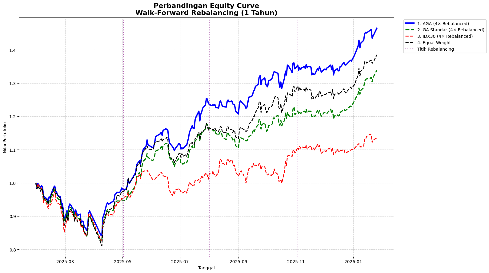
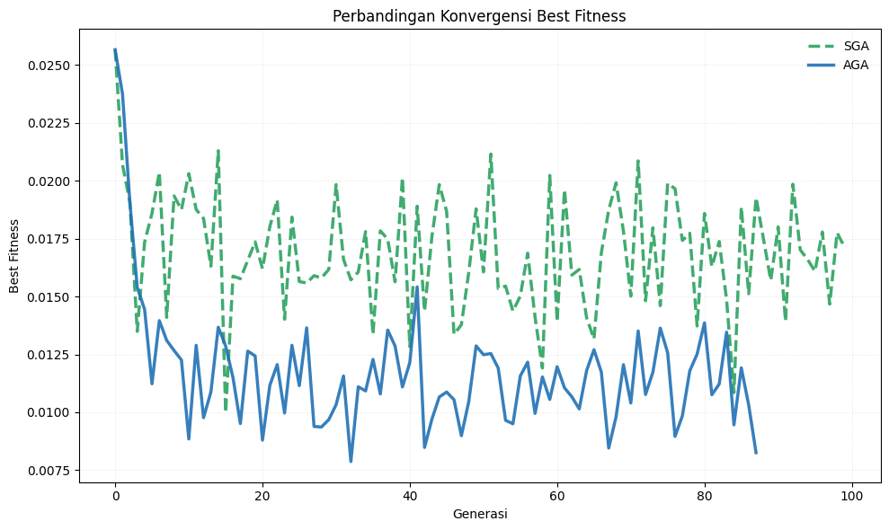
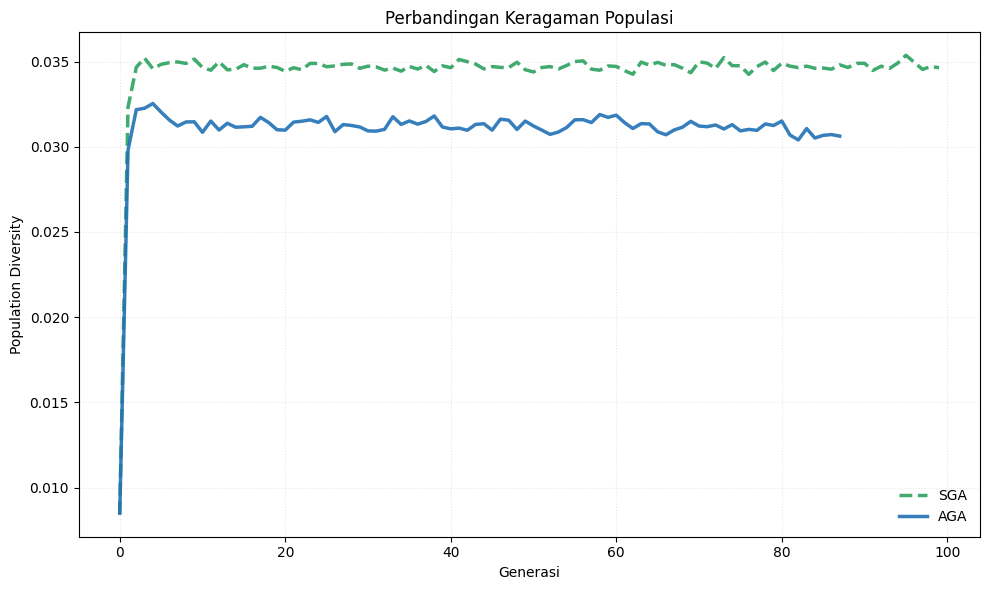
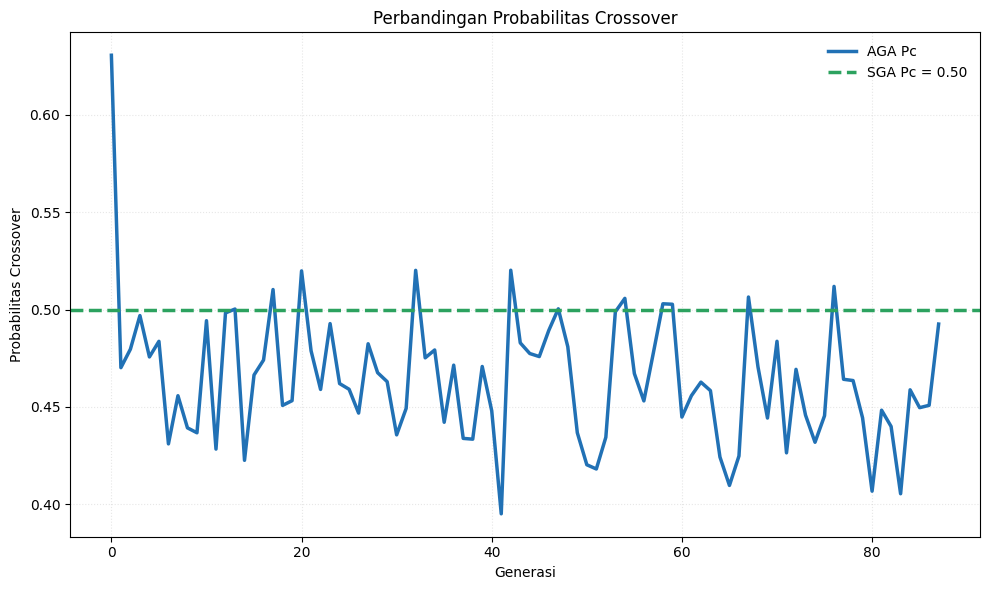
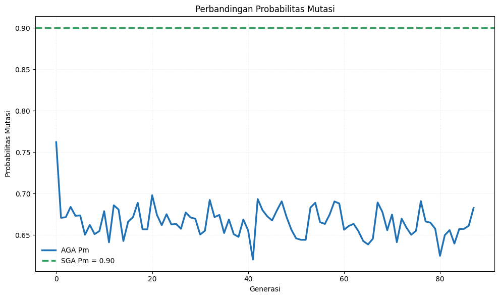
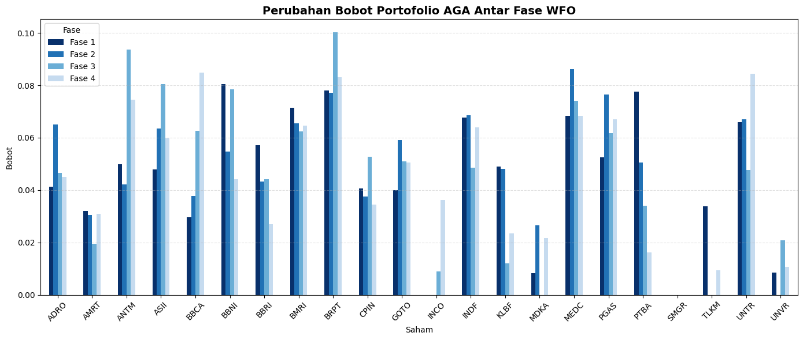
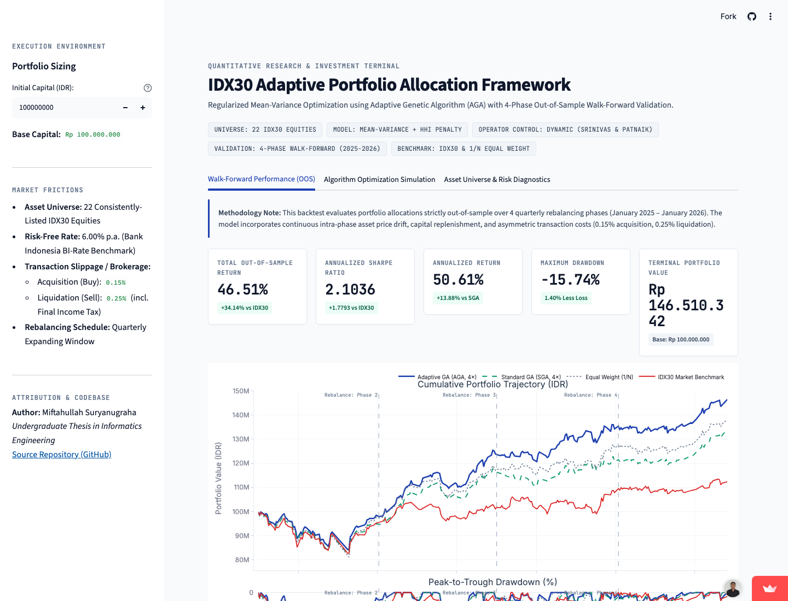

# Dynamic Stock Portfolio Optimization on IDX30 Using Adaptive Genetic Algorithm (AGA) and Walk-Forward Validation

[](https://www.python.org/)
[](https://portfolio-optimization-aga.streamlit.app)
[](LICENSE)
[]()
[]()
[]()

> 🌐 **Live Interactive Web Dashboard:** [https://portfolio-optimization-aga.streamlit.app](https://portfolio-optimization-aga.streamlit.app)  
> **Undergraduate Thesis Project (*Skripsi*)** | **Author:** Miftahullah Suryanugraha  
> **Keywords:** Quantitative Finance, Portfolio Optimization, Adaptive Genetic Algorithm (AGA), Mean-Variance Theory, Walk-Forward Optimization, Paired Statistical Validation, Transaction Cost Modeling.

---

## 📌 Executive Summary

Modern portfolio optimization often struggles with **non-convex constraints** (upper-bound allocation caps, concentration penalties) and **dynamic market regimes**. Standard Genetic Algorithms (SGA) with static operators frequently suffer from **premature convergence** into suboptimal local optima or excessive gene disruption during late-stage exploitation.

This project implements an end-to-end quantitative framework applying an **Adaptive Genetic Algorithm (AGA)** to dynamically optimize portfolio weights across $N = 22$ consistently listed constituent stocks of the **IDX30 Index** (Indonesia Stock Exchange).

### Key Innovations & Highlights
1. **Dynamic Evolutionary Operators:** Automatically adapts crossover ($P_c$) and mutation ($P_m$) probabilities per individual based on population fitness distribution, preserving diversity in early generations and accelerating convergence during late stages.
2. **Regularized Mean-Variance Objective Function:** Maximizes the daily Sharpe Ratio while penalizing concentration risk via the **Herfindahl-Hirschman Index (HHI)** ($\lambda_{\text{div}} = 0.90$, tuned via 2-phase WFO Grid Search from initial $\lambda_{\text{div}} = 0.10$) under single-asset weight caps ($w_{\max} = 10\%$, tuned from initial $30\%$) and an iterative proportional excess-redistribution repair operator (`max_iters = 15`).
3. **Realistic Walk-Forward Backtesting (WFO):** Evaluated over **4 expanding-window out-of-sample phases** (January 2025 – January 2026, 235 trading days) both in **isolated per-phase backtests** and a **continuous 4× rebalanced cumulative backtest** incorporating intra-phase price drift and realistic **asymmetric transaction costs** (0.15% buy fee, 0.25% sell fee + tax).
4. **Extended Multi-Run Statistical Evaluation:** Evaluates stochastic optimization stability across **80 paired experimental runs** (4 phases $\times$ 10 paired seeds $\times$ 2 algorithms with shared initial populations under an equal $44,000$ NFE budget) using a two-stage pipeline: **Shapiro-Wilk normality tests** on paired differences followed by **Paired Student's t-tests** (parametric) or **Wilcoxon Signed-Rank tests** (non-parametric).

---

## 🏆 Key Performance Results (Out-of-Sample Walk-Forward Backtest)

### 1. Cumulative Walk-Forward Performance (4× Rebalanced, Jan 2025 – Jan 2026)
Over the full out-of-sample evaluation horizon (`2025-01-30` to `2026-01-26`), the **AGA Strategy (4× Rebalanced)** achieved the highest risk-adjusted performance across all strategies:

| Rank | Investment Strategy | Total Return (%) | Annualized Return (%) | Annualized Volatility (%) | Sharpe Ratio | Max Drawdown (%) | Net Transaction Cost (%) | Final Portfolio Value |
| :---: | :--- | :---: | :---: | :---: | :---: | :---: | :---: | :---: |
| 🥇 | **Adaptive Genetic Algorithm (AGA, 4× Rebalanced)** | **46.4914%** | **50.5937%** | **21.2094%** | **2.1025** | **-15.7424%** | 0.4291% | **1.4649** |
| 🥈 | **Equal Weight Benchmark (1/N Buy & Hold)** | 38.5142% | 41.8176% | 22.4410% | 1.5961 | -18.7795% | 0.1500% | 1.3851 |
| 🥉 | **Standard Genetic Algorithm (SGA, 4× Rebalanced)** | 33.8970% | 36.7545% | 21.2583% | 1.4467 | -17.3522% | 0.4979% | 1.3390 |
| 4 | **IDX30 Market Index Benchmark (4× Rebalanced)** | 13.4829% | 14.5260% | 22.6332% | 0.3767 | -17.1428% | 0.3775% | 1.1348 |

> **Key Takeaway:** AGA delivered **+33.01% higher total return** (`46.49%` vs. `13.48%`) and **+458% higher Sharpe Ratio** (`2.1025` vs. `0.3767`) compared to the official IDX30 Index benchmark, while limiting maximum drawdown to **-15.74%** (the lowest among all evaluated strategies).

### 2. Isolated Per-Phase Walk-Forward Performance (Fase 1 – Fase 4)
Performance of each individual 3-month out-of-sample test window (each initialized with `0.15%` entry cost and ranked by Sharpe Ratio):

| Phase | Rank | Strategy | Total Return (%) | Annual Return (%) | Annual Volatility (%) | Sharpe Ratio | Max Drawdown (%) | Transaction Cost (%) |
| :---: | :---: | :--- | :---: | :---: | :---: | :---: | :---: | :---: |
| **Fase 1** *(Feb–Apr 2025)* | 1 | **AGA (Fase 1)** | **-1.5474%** | **-6.6621%** | **32.6149%** | **-0.3882** | **-15.7424%** | 0.15% |
| Fase 1 | 2 | Equal Weight (Fase 1) | -2.4597% | -10.4259% | 35.6571% | -0.4607 | -18.7795% | 0.15% |
| Fase 1 | 3 | IDX30 (Fase 1) | -4.7369% | -19.3088% | 36.1163% | -0.7008 | -17.1428% | 0.15% |
| Fase 1 | 4 | SGA (Fase 1) | -5.0989% | -20.6559% | 33.1101% | -0.8051 | -17.3522% | 0.15% |
| **Fase 2** *(May–Jul 2025)* | 1 | **AGA (Fase 2)** | **25.8246%** | **171.3091%** | **17.7922%** | **9.2911** | **-5.6535%** | 0.15% |
| Fase 2 | 2 | SGA (Fase 2) | 22.5366% | 141.8243% | 17.8748% | 7.5987 | -6.2541% | 0.15% |
| Fase 2 | 3 | Equal Weight (Fase 2) | 19.9154% | 120.1397% | 17.5609% | 6.4997 | -6.6488% | 0.15% |
| Fase 2 | 4 | IDX30 (Fase 2) | 6.0985% | 29.3308% | 16.3216% | 1.4294 | -7.3740% | 0.15% |
| **Fase 3** *(Aug–Oct 2025)* | 1 | **AGA (Fase 3)** | **8.2338%** | **36.5537%** | **16.2624%** | **1.8788** | **-3.8129%** | 0.15% |
| Fase 3 | 2 | Equal Weight (Fase 3) | 7.8951% | 34.8788% | 15.7500% | 1.8336 | -3.7337% | 0.15% |
| Fase 3 | 3 | IDX30 (Fase 3) | 7.7113% | 33.9764% | 19.0369% | 1.4696 | -6.7133% | 0.15% |
| Fase 3 | 4 | SGA (Fase 3) | 3.5376% | 14.6698% | 15.9206% | 0.5446 | -5.1580% | 0.15% |
| **Fase 4** *(Nov 2025–Jan 2026)* | 1 | **SGA (Fase 4)** | **11.0509%** | **60.2692%** | **12.6101%** | **4.3036** | **-2.4225%** | 0.15% |
| Fase 4 | 2 | Equal Weight (Fase 4) | 8.9500% | 47.0697% | 12.5986% | 3.2599 | -2.9339% | 0.15% |
| Fase 4 | 3 | AGA (Fase 4) | 9.0204% | 47.4976% | 13.2826% | 3.1242 | -2.3100% | 0.15% |
| Fase 4 | 4 | IDX30 (Fase 4) | 4.0090% | 19.3493% | 12.1106% | 1.1023 | -2.8113% | 0.15% |

---

## 📈 Visual Highlights

### 1. Cumulative Walk-Forward Equity Curve & Drawdown
Comparison of portfolio wealth growth and peak-to-trough drawdowns across the 4 forward phases (including rebalancing friction):



### 2. Evolutionary Dynamics: SGA vs. AGA
AGA demonstrates faster convergence to superior objective values while sustaining healthier population diversity:

| Best Fitness Convergence Trajectory | Population Diversity Trajectory |
| :---: | :---: |
|  |  |

### 3. Dynamic Operator Rate Adaptation ($P_c$ and $P_m$)
Evolution of adaptive crossover probability ($P_c$) and mutation probability ($P_m$) across generations:

| Adaptive Crossover Rate ($P_c$) | Adaptive Mutation Rate ($P_m$) |
| :---: | :---: |
|  |  |

### 4. Out-of-Sample Dynamic Asset Allocation Across 4 Phases
Evolution of optimized asset weights across rebalancing horizons:



---

## 📐 Mathematical & Algorithmic Formulation

### 1. Mean-Variance Portfolio Framework
For an investment universe of $N = 22$ consistent assets with daily expected return vector $\boldsymbol{\mu} \in \mathbb{R}^N$ and covariance matrix $\boldsymbol{\Sigma} \in \mathbb{R}^{N \times N}$, portfolio expected return and volatility are defined as:
$$E = \mathbf{w}^T \boldsymbol{\mu}, \quad \sigma = \sqrt{\mathbf{w}^T \boldsymbol{\Sigma} \mathbf{w} + 10^{-6}}$$

### 2. Regularized Minimization Fitness Function
To prevent asset over-concentration and enforce diversification, the objective function minimizes the negative Sharpe ratio plus a **Herfindahl-Hirschman Index (HHI)** diversification penalty and a quadratic upper-bound penalty:
$$\min_{\mathbf{w}} \mathcal{F}(\mathbf{w}) = -\left( \frac{\mathbf{w}^T \boldsymbol{\mu}}{\sqrt{\mathbf{w}^T \boldsymbol{\Sigma} \mathbf{w} + 10^{-6}}} \right) + \lambda_{\text{div}} \sum_{i=1}^N w_i^2 + 1000 \sum_{i=1}^N \max(0, w_i - w_{\max})^2$$

Where (after 2-phase WFO Grid Search tuning on the validation set):
- $\lambda_{\text{div}} = 0.90$ (tuned diversification penalty weight; initial baseline $= 0.10$)
- $w_{\max} = 0.10$ (tuned maximum 10% allocation cap per asset; initial baseline $= 0.30$)
- Budget & long-only constraints: $\sum_{i=1}^N w_i = 1, \; w_i \ge 0$, enforced via iterative proportional excess redistribution (`repair_weights`, `max_iters = 15`).

### 3. Adaptive Genetic Algorithm Operator Formulations
Instead of static operator rates, AGA calculates individual crossover and mutation probabilities relative to the population's fitness distribution:

$$\text{Let } f_c = \min(f_1, f_2), \quad f_{\text{ind}} = \frac{f_1 + f_2}{2}, \quad f_{\text{avg}} = \frac{1}{M}\sum_{i=1}^M f_i, \quad f_{\min} = \min_{i} f_i$$

**Adaptive Crossover Probability ($P_c$):**
$$P_c = \begin{cases} 
\max\!\left(k_1 - \frac{(k_1 - k_3)(f_{\text{avg}} - f_c)}{f_{\text{avg}} - f_{\min}}, \; k_3\right), & \text{if } f_c \le f_{\text{avg}} \\
k_2, & \text{if } f_c > f_{\text{avg}}
\end{cases}$$

**Adaptive Mutation Probability ($P_m$):**
$$P_m = \begin{cases} 
\max\!\left(k_4 - \frac{(k_4 - k_6)(f_{\text{avg}} - f_{\text{ind}})}{f_{\text{avg}} - f_{\min}}, \; k_6\right), & \text{if } f_{\text{ind}} \le f_{\text{avg}} \\
k_5, & \text{if } f_{\text{ind}} > f_{\text{avg}}
\end{cases}$$

**Tuned Hyperparameters (Equal $44,000$ NFE Budget):**
- **SGA:** Population $M = 440$, Generations $G = 100$, Fixed $P_c = 0.5, \; P_m = 0.9$
- **AGA:** Population $M = 500$, Generations $G = 88$, Adaptive scaling $k_1 = 0.9, \; k_2 = 0.9, \; k_3 = 0.1, \; k_4 = 0.9, \; k_5 = 0.9, \; k_6 = 0.3$

---

## 🔬 Extended Multi-Run Statistical Evaluation

> **Methodological Context:** Because SGA and AGA are stochastic population-based metaheuristics whose trajectories depend on random initialization and genetic operators, an extended statistical evaluation is performed to test whether AGA's optimization advantage is statistically consistent rather than an artifact of a single random seed.

### Experimental Design & Two-Stage Testing Protocol
1. **Paired Multi-Start Design ($4 \text{ Phases} \times 10 \text{ Runs} \times 2 \text{ Algorithms} = 80 \text{ Runs}$):**
   - For each retraining phase (`Fase 1` to `Fase 4`) and each run $r \in \{1, \dots, 10\}$ (`seed_run = 29 + r - 1`), a **shared initial population (`shared_population`)** is generated so that both SGA and AGA begin from identical starting chromosomes under the exact same $44,000$ function evaluation budget.
   - This produces $n = 10$ strictly **paired observations** $(X_{\text{SGA}, r}, X_{\text{AGA}, r})$ per phase for three metrics: **Objective Fitness** (minimization), **In-Sample Daily Sharpe Ratio** (maximization), and **Computation Runtime (s)**.
2. **Stage 1 — Normality Check on Paired Differences:**
   - Compute paired differences $d_r = X_{\text{AGA}, r} - X_{\text{SGA}, r}$ for $r = 1, \dots, 10$.
   - Apply the **Shapiro-Wilk normality test** (`scipy.stats.shapiro`) at significance threshold $\alpha = 0.05$, selected for its superior statistical power on small sample sizes ($n = 10$).
3. **Stage 2 — Conditional Parametric / Non-Parametric Hypothesis Test:**
   - If $p_{\text{Shapiro}} > 0.05$ (**Normal**): apply the two-sided **Paired Student's t-test** (`scipy.stats.ttest_rel(aga, sga)`).
   - If $p_{\text{Shapiro}} \le 0.05$ (**Non-Normal**): apply the two-sided **Wilcoxon Signed-Rank test** (`scipy.stats.wilcoxon(aga, sga)`).

| Phase | Metric Tested | Mean SGA $\pm$ SD | Mean AGA $\pm$ SD | Normality Test | $p$-value (Normality) | Distribution | Statistical Test | Statistic | $p$-value | Conclusion ($\alpha=0.05$) |
| :---: | :---: | :---: | :---: | :---: | :---: | :---: | :---: | :---: | :---: | :---: |
| **Fase 1** | Fitness (Objective) | $0.016800 \pm 0.003267$ | **$0.011102 \pm 0.000943$** | Shapiro-Wilk | 0.706612 | Normal | Paired t-test | $t = -6.2820$ | **$0.000144$** | Significant |
| **Fase 2** | Fitness (Objective) | $0.028264 \pm 0.001703$ | **$0.022160 \pm 0.000594$** | Shapiro-Wilk | 0.500916 | Normal | Paired t-test | $t = -9.4565$ | **$0.000006$** | Significant |
| **Fase 3** | Fitness (Objective) | $0.004860 \pm 0.002529$ | **$-0.000841 \pm 0.001058$** | Shapiro-Wilk | 0.512746 | Normal | Paired t-test | $t = -8.0051$ | **$0.000022$** | Significant |
| **Fase 4** | Fitness (Objective) | $-0.001956 \pm 0.001619$ | **$-0.007153 \pm 0.000941$** | Shapiro-Wilk | 0.367356 | Normal | Paired t-test | $t = -8.7718$ | **$0.000011$** | Significant |
| **Fase 1** | Sharpe Ratio (In-Sample) | $0.040993 \pm 0.004558$ | **$0.046926 \pm 0.002741$** | Shapiro-Wilk | 0.463569 | Normal | Paired t-test | $t = 3.1145$ | **$0.012429$** | Significant |
| **Fase 2** | Sharpe Ratio (In-Sample) | $0.025845 \pm 0.006746$ | **$0.033629 \pm 0.002057$** | Shapiro-Wilk | 0.038636 | Non-Normal | Wilcoxon Signed-Rank | $W = 0.0000$ | **$0.001953$** | Significant |
| **Fase 3** | Sharpe Ratio (In-Sample) | $0.051836 \pm 0.007653$ | **$0.055105 \pm 0.003599$** | Shapiro-Wilk | 0.317137 | Normal | Paired t-test | $t = 1.9459$ | $0.083519$ | Not Significant |
| **Fase 4** | Sharpe Ratio (In-Sample) | $0.056923 \pm 0.006109$ | **$0.061369 \pm 0.004175$** | Shapiro-Wilk | 0.914355 | Normal | Paired t-test | $t = 1.6514$ | $0.133056$ | Not Significant |

> Across all 4 phases, AGA achieved **statistically significant improvements in objective fitness ($p < 0.001$ in every phase)** with $2\times$–$3\times$ lower standard deviation across runs, confirming superior search convergence and multi-run stability under the regularized objective.

---

## 📁 Repository Structure

```text
.
├── app.py                                 # Interactive Streamlit Web Application
├── LICENSE                                # MIT Open-Source License
├── README.md                              # Main GitHub documentation
├── requirements.txt                       # Python package dependencies (incl. Streamlit & Plotly)
├── .streamlit/
│   └── config.toml                        # Streamlit visual theme & server settings
├── data/
│   └── raw/
│       ├── IDX30-List.csv                 # Historical IDX30 constituents review records
│       └── IDX30-Scraping.csv             # Daily historical stock prices (2022-2026)
├── docs/
│   └── CV_PORTFOLIO_HIGHLIGHTS.md         # Bilingual CV bullet points (English & Indonesian)
├── notebooks/
│   ├── 01_data_scraping.ipynb             # Automated Yahoo Finance scraping pipeline
│   └── 02_idx30_portfolio_optimization_aga.ipynb # Complete reproducible thesis notebook
├── results/
│   ├── figures/                           # High-resolution publication charts (.png)
│   └── tables/                            # Verified quantitative performance tables (.csv)
└── src/                                   # Modular Python package aligned with thesis
    ├── __init__.py                        # Package namespace exports
    ├── backtest.py                        # Multi-phase WFO backtest engine with transaction fees
    ├── config.py                          # Constants, tuned hyperparameters, and temporal splits
    ├── data_loader.py                     # Preprocessing, filtering, and WFO phase slicing
    ├── objectives.py                      # Regularized Mean-Variance fitness & weight repairs
    ├── optimizers.py                      # SGA and Adaptive Genetic Algorithm implementations
    ├── statistics.py                      # Shapiro-Wilk, Paired t-test, & Wilcoxon evaluation
    └── visualization.py                   # Chart generation and publication plotting routines
```

---

## 🖥️ Quantitative Research & Investment Terminal (Streamlit App)

> **Live Terminal Online:** [https://portfolio-optimization-aga.streamlit.app](https://portfolio-optimization-aga.streamlit.app)

The repository includes an interactive **Streamlit Quantitative Research & Investment Terminal (`app.py`)** presenting the multi-phase Walk-Forward backtest results, live evolutionary simulations, and Indonesia Stock Exchange (IDX) lot sizing calculations:



### Terminal Architecture & Component Breakdown

#### 1. Execution Environment & Market Friction Controls (Sidebar)
- **Dynamic Capital Sizing:** User-configurable investment capital in Indonesian Rupiah (default: `Rp 100,000,000`), dynamically recalculating nominal asset allocations and trading lot requirements.
- **Explicit Friction Disclosures:**
  - **Acquisition Cost (Buy):** `0.15%` brokerage commission.
  - **Liquidation Cost (Sell):** `0.25%` (`0.15%` brokerage + `0.10%` PPh Final transaction tax).
  - **Risk-Free Rate:** `6.00%` p.a. (Bank Indonesia BI-Rate benchmark).

#### 2. Tab 1 — Walk-Forward Performance (OOS)
- **Exact Thesis KPI Scorecards:**
  - **Total Out-of-Sample Return:** **46.49%** (`+33.01% vs. IDX30 Index`)
  - **Annualized Sharpe Ratio:** **2.1025** (`+1.7258 vs. IDX30 Index`)
  - **Annualized Return:** **50.59%** (`+13.84% vs. Standard GA`)
  - **Maximum Drawdown:** **-15.74%** (`1.40% less loss than benchmark`)
  - **Terminal Portfolio Value:** **Rp 146.491.375** (net wealth on Rp 100M starting capital)
- **Synchronized Plotly Dual-Axis Curves:** Continuous daily cumulative portfolio trajectory (IDR) and peak-to-trough drawdowns (%) across all 4 forward phases.
- **Cumulative & Isolated Phase Tables:** Displays both the 4× rebalanced cumulative WFO summary and the isolated per-phase performance table (`Fase 1` – `Fase 4`).
- **Actionable IDX Lot Allocation Engine:** Converts optimization weights $\mathbf{w}$ into round trading lots compliant with Indonesia Stock Exchange rules (**1 Lot = 100 shares**).

#### 3. Tab 2 — Algorithm Optimization Simulation (Live AGA vs. SGA)
- **Interactive Controls:** Customize constituent tickers and hyperparameters (pre-loaded with the tuned thesis defaults: $w_{\max} = 10\%$, $\lambda_{\text{div}} = 0.90$).
- **Side-by-Side Evolutionary Diagnostics:** Real-time Plotly curves comparing objective fitness convergence, chromosome diversity preservation, and dynamic $P_c$ / $P_m$ rate trajectories.

#### 4. Tab 3 — Asset Universe & Risk Diagnostics
- **Cross-Sectional Risk vs. Return Scatter:** Annualized volatility vs. expected return across the 22 consistent IDX30 equities.
- **Correlation Heatmap & Normalized Price Viewer:** $22 \times 22$ pairwise return correlation matrix and historical price trajectories (`Base = 100`).

---

## 🚀 Quickstart & Local Reproduction

```bash
# 1. Clone the repository
git clone https://github.com/miftahsuryan/idx30-portfolio-optimization-aga.git
cd idx30-portfolio-optimization-aga

# 2. Create virtual environment and install dependencies
python3 -m venv .venv
source .venv/bin/activate
pip install -r requirements.txt

# 3. Launch the Streamlit application
streamlit run app.py
```

---

## 📜 Citation & Academic Attribution

```bibtex
@misc{suryanugraha2026idx30aga,
  author       = {Miftahullah Suryanugraha},
  title        = {Implementation of IDX30 Stock Portfolio Optimization Using Adaptive Genetic Algorithm (AGA)},
  year         = {2026},
  publisher    = {GitHub},
  howpublished = {\url{https://github.com/miftahsuryan/idx30-portfolio-optimization-aga}}
}
```

---

## 📄 License

This repository is licensed under the [MIT License](LICENSE).
